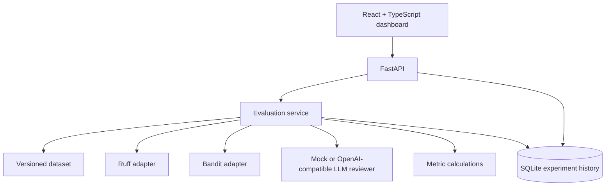

# ReviewSignal AI — Code Review Reliability Evaluation Platform

ReviewSignal AI is a portfolio project that evaluates how reliably code-review methods identify known issues in Python snippets. It compares deterministic static-analysis tools (Ruff and Bandit, when installed) with an LLM reviewer, then calculates transparent evaluation metrics against a small, version-controlled benchmark dataset.

> **Project status:** MVP scaffold. The deterministic evaluator and mock reviewer are designed to work without paid API credentials. LLM provider results depend on configuration. Benchmark results are only meaningful for the included dataset and matching rules; do not generalize them to all code or models.

## Features

- FastAPI backend with OpenAPI documentation.
- Versioned JSON dataset with expected findings.
- Ruff and Bandit adapters (gracefully report unavailable tools).
- Mock reviewer for repeatable offline demos.
- Optional OpenAI-compatible chat-completions endpoint via HTTP.
- Precision, recall, F1, false-positive rate, and confusion counts.
- SQLite experiment history and JSON export.
- React + TypeScript frontend.
- Tests for metric calculations and API behavior.
- Docker and GitHub Actions configuration.

## Architecture



## Requirements

- Python 3.11 or newer
- Node.js 20 or newer (only for frontend development)
- Optional: Ruff, Bandit, and an OpenAI-compatible API endpoint

## Run the backend

```bash
python -m venv .venv
# macOS/Linux
source .venv/bin/activate
# Windows PowerShell: .venv\Scripts\Activate.ps1

pip install -r requirements.txt
cp .env.example .env
uvicorn app.main:app --reload
```

Open http://127.0.0.1:8000/docs for the API documentation and http://127.0.0.1:8000/ for the dashboard landing page.

### Run with Docker

```bash
docker compose up --build
```

The backend is exposed on port 8000. The React frontend can be run separately using the instructions below.

## Run the frontend

```bash
cd frontend
npm install
npm run dev
```

Vite typically serves the app on http://localhost:5173. The development server proxies `/api` requests to `http://localhost:8000`.

## Configure the AI reviewer

By default, `LLM_PROVIDER=mock`; no API key is required and results are deterministic.

For an OpenAI-compatible chat-completions endpoint, set these in `.env`:

```env
LLM_PROVIDER=openai_compatible
LLM_BASE_URL=https://api.openai.com/v1
LLM_MODEL=YOUR_MODEL_NAME
LLM_API_KEY=YOUR_API_KEY
```

Do not commit real API keys. Check the provider's data-handling terms before sending source code to an external service. The optional provider sends only the selected benchmark snippet and a constrained review prompt. The sample project does not execute submitted code.

## API endpoints

- `GET /health` — health check
- `GET /api/dataset` — dataset metadata and cases
- `POST /api/experiments` — run an experiment
- `GET /api/experiments` — list saved experiments
- `GET /api/experiments/{experiment_id}` — fetch one experiment
- `GET /api/experiments/{experiment_id}/export` — export experiment as JSON

Example:

```bash
curl -X POST http://127.0.0.1:8000/api/experiments \
  -H "Content-Type: application/json" \
  -d '{"reviewers":["mock","ruff","bandit"]}'
```

## Metrics and matching methodology

The included dataset defines expected issue labels per sample. A detected finding is counted as a true positive when its normalized category matches an expected category for that sample. An unmatched detected category is a false positive; an expected category not detected is a false negative. Each category is counted at most once per sample to avoid duplicate findings inflating scores.

- Precision = TP / (TP + FP)
- Recall = TP / (TP + FN)
- F1 = 2 × Precision × Recall / (Precision + Recall)
- False-positive rate = FP / (FP + TN)

For the false-positive rate, TN is the number of absent issue categories not reported in each sample, over the fixed category vocabulary used by the evaluator. Because the dataset is small and the matching is category-based, metrics are educational and should not be treated as a comprehensive benchmark.

Static analyzers do not detect every expected category, and tool rule IDs are mapped to broad categories where possible. The mock reviewer is a deterministic demonstration fixture, not an AI model and not evidence of model performance.

## Security notes

- The application analyzes static source text and does not execute submitted Python snippets.
- Ruff and Bandit are invoked on temporary files only when installed; neither is used as a general-purpose code execution environment.
- Treat source code and model output as untrusted data.
- Never store API credentials in source control.
- If adapting this app to arbitrary user submissions, add authentication, rate limiting, quotas, privacy controls, and stricter isolation before public deployment.
- The sample app is a portfolio MVP, not a security-certified production service.

## Tests

```bash
pytest
```

## Project structure

```text
ReviewSignal-AI/
├── app/
│   ├── main.py
│   ├── config.py
│   ├── database.py
│   ├── models.py
│   ├── schemas.py
│   ├── dataset.py
│   ├── metrics.py
│   ├── evaluation.py
│   └── reviewers/
├── data/benchmark.json
├── frontend/
├── tests/
├── .github/workflows/ci.yml
├── Dockerfile
├── docker-compose.yml
├── requirements.txt
└── .env.example
```

## Known limitations

- The bundled benchmark is intentionally small and hand-authored.
- Matching uses normalized issue categories, not semantic or line-level adjudication.
- Static-analysis adapters may report unavailable if the optional tools are not installed.
- The mock reviewer is for deterministic demos only.
- Model output and metrics depend on provider behavior, configuration, and the selected dataset.
- No authentication or multi-user access control is included.

## Roadmap

- Expand and independently review the benchmark dataset.
- Add versioned rule mappings and line-aware matching.
- Add authentication and per-user experiment ownership.
- Add benchmark export and reproducibility metadata.
- Compare multiple LLM providers using the same cases and prompts.

## Portfolio publication checklist

- [ ] Run tests locally and record the actual result.
- [ ] Run the backend and frontend locally.
- [ ] Capture real screenshots from the running application.
- [ ] Review `.env` and Git history for secrets.
- [ ] Replace placeholders in your profile with real repository/demo URLs.
- [ ] Explain that this is your implementation and accurately describe any AI assistance used.
